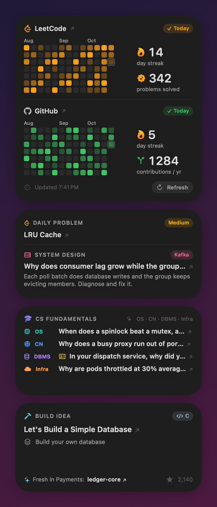
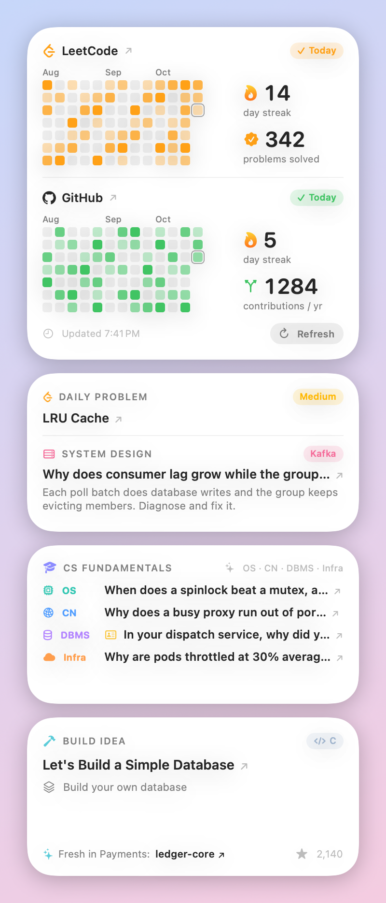
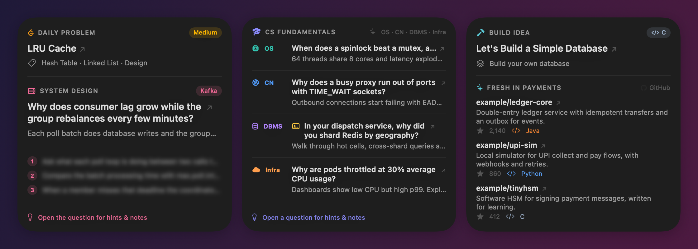
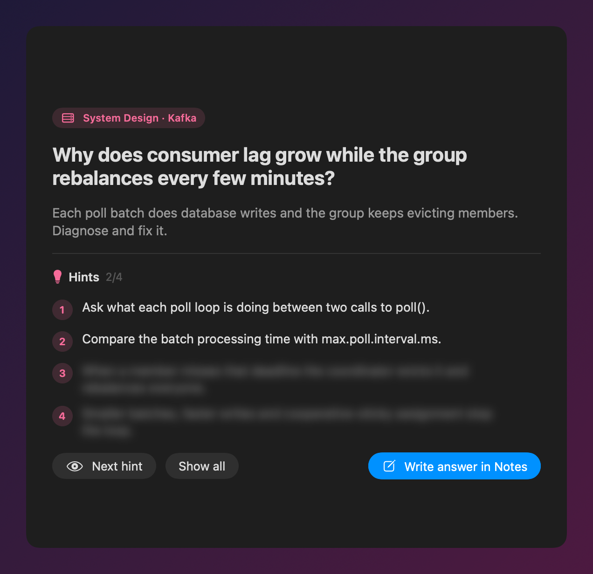

<div align="center">

# DevBoard

**Native macOS widgets for developers who are leveling up.**
Your LeetCode and GitHub streaks, a daily LeetCode problem, AI-written interview questions with hints
(system design, OS, networks, DBMS, infra), questions spun from *your own resume*, and a project to build.





</div>

## Why DevBoard

- **Zero effort, every day.** Open Notification Center and your practice for the day is already there.
- **Practice like a real interview.** Questions are specific production scenarios with four progressive hints, not trivia.
- **Grilled on your own work.** Hand over your resume once; every day one question probes a project you actually built.
- **Answers in Apple Notes.** One click creates a note titled with the question, so your prep stays searchable.
- **Featherweight.** Native WidgetKit: no background app, no Electron, no web view. It wakes up once an hour and sleeps the rest of the time.
- **No Xcode.** Builds in under a minute with Apple's free Command Line Tools.

## The widgets

| Widget | Sizes | What it shows |
|---|---|---|
| **Activity** | Large | LeetCode + GitHub heatmaps for the last 3 months, streaks 🔥, problems solved, contributions, refresh button |
| **Today** | Medium, Large | LeetCode daily problem + an AI-written system design question |
| **CS Fundamentals** | Medium, Large | One OS, Networks, DBMS and Infra question per day |
| **Build Idea** | Medium, Large | A "build X from scratch" project in C, C++, Java or Python + fresh GitHub repos in a rotating domain (payments, security, banking, OS, databases…) |



Click any question title to open the **hints page**: reveal hints one at a time, then **Write answer in Notes**.

<div align="center"></div>

Only titles (marked ↗) are clickable, so you never open something by accident.

## Install

Requirements: **macOS 14 Sonoma or later** and Apple's free Command Line Tools (`xcode-select --install`).

```bash
git clone https://github.com/Sumit063/devboard.git
cd devboard
./setup.sh
```

`setup.sh` asks for:

1. **Your LeetCode and GitHub usernames** (either can be left blank).
2. **An AI provider and API key** (optional, recommended). Pick one:
   - **Gemini**: free, no card. Get a key at [aistudio.google.com/apikey](https://aistudio.google.com/apikey).
   - **Claude**: get a key at [console.anthropic.com](https://console.anthropic.com/settings/keys). Uses `claude-opus-5-5` by default.
   - **OpenAI-compatible**: any API that speaks OpenAI's Chat Completions: OpenAI, OpenRouter, Groq, Together, or a local Ollama / LM Studio (`http://localhost:11434/v1`). You choose the base URL and model.

   Without a key, everything except the AI questions still works.
3. **Your resume** (optional): a PDF, DOCX, TXT, Markdown or LaTeX file. See [Resume handoff](#resume-handoff).

It then builds the app and installs it to `~/Applications/DevBoard.app`.

**Add the widgets:** click the date and time in the menu bar → **Edit Widgets** (or right-click the desktop) → search **DevBoard**.
A stack of Activity (Large) + Today, CS Fundamentals and Build Idea (Medium) fills a laptop-height Notification Center.

The first time you click **Write answer in Notes**, macOS asks to let DevBoard control Notes. Click **Allow**.

## Resume handoff

Resume-based questions make practice personal: *"In your dispatch service, why did you shard Redis by geography, and what happens when a shard fails?"*

How it works, with privacy first:

1. `setup.sh` extracts the text **on your Mac** (PDFKit / `textutil`, nothing installed).
2. Emails, phone numbers and links are **scrubbed locally** before anything leaves your machine.
3. Your AI provider rewrites the rest into a ~300-word tech profile **with no name, employers, schools or locations**. Companies become "a large fintech company" and so on.
4. You **review the profile** and save, edit or discard it. It is stored only at `~/.config/devboard/profile.txt`.
5. Each day, one question slot (rotating OS → Networks → DBMS → Infra → System design) is written from that profile. It's tagged **From your resume**, and its note title starts with `[RESUME]`.

Prefer not to send your resume anywhere? Copy [`profile.example.txt`](profile.example.txt) to `~/.config/devboard/profile.txt`, write your own summary, and run `./build.sh`.

> Some providers' free tiers (Gemini's included) may use prompts to improve their products. That's why only the anonymized profile is ever used for questions.

## Configuration

Everything personal lives in `~/.config/devboard/` (permissions `600`), never in this repo:

| File | Purpose |
|---|---|
| `config.json` | Usernames and options (see [`config.example.json`](config.example.json)) |
| `api_key` | Your Gemini, Claude or OpenAI-compatible API key |
| `profile.txt` | Your anonymized resume profile |

```json
{
  "leetcode_username": "your-leetcode-username",
  "github_username": "your-github-username",
  "notes_folder": "Daily Problems",
  "resume_questions": true,
  "ai_provider": "gemini",
  "ai_model": "",
  "ai_base_url": ""
}
```

- `ai_provider`: `gemini` (default), `claude`, or `openai` (any OpenAI-compatible API).
- `ai_model`: overrides the default model. Required for `openai`.
- `ai_base_url`: only for `openai`; defaults to `https://api.openai.com/v1`.

After editing any of these, run `./build.sh`. The widget is sandboxed, so settings are copied into the app bundle at build time. Or just run `./setup.sh` again.

## How it works

```
Notification Center ─▶ DevBoardWidget.appex (sandboxed, hourly timeline)
                         ├─ LeetCode GraphQL ........ heatmap, solved count, daily problem
                         ├─ GitHub contributions .... heatmap (public page, no token)
                         ├─ build-your-own-x ........ daily project idea (cached 24h)
                         ├─ GitHub search ........... fresh repos for the day's domain
                         └─ AI provider (1 call/day)  5 questions + hints, cached for the day
            clicks ─▶ DevBoard.app (tiny helper, quits when done)
                         ├─ opens links in your browser
                         ├─ hints page (SwiftUI)
                         └─ Apple Notes via AppleScript
```

- **Refresh:** hourly and just after midnight; the **Refresh** button forces it. All widgets share one fetch.
- **Questions:** each subject rotates through ~35 subtopics so days don't repeat. The AI provider writes the question, scenario and hints. On Gemini, `gemini-3.8-flash` is used first and overloaded models fall back automatically.
- **Resilient:** any source that fails keeps its last good data; failed question generation retries every 10 minutes.

Project layout:

```
App/        helper app: link routing, hints page, Notes
Widget/     the four widgets (SwiftUI + WidgetKit)
Shared/     models, fetchers, AI question generator
scripts/    resume → profile (text extraction + anonymization)
Support/    Info.plists, entitlements
Tools/      screenshot renderer for this README
```

## Customize

- **Subtopics:** edit the lists in [`Shared/CSGenerator.swift`](Shared/CSGenerator.swift) (`topics`).
- **Interviewer style:** edit `instructions` in the same file.
- **Resume frequency:** change `resumeSlot(_:)` (one per day by default), or set `"resume_questions": false`.
- **Build-idea domains:** edit `FreshRepos.topics` in [`Shared/Fetchers.swift`](Shared/Fetchers.swift).
- **Screenshots:** `Tools/screenshots/render.sh` regenerates the images above from demo data.

## Troubleshooting

| Problem | Fix |
|---|---|
| DevBoard isn't in Edit Widgets | Run `./build.sh` again, then close and reopen Edit Widgets. If it's still missing, run `killall chronod` and try once more. |
| "Set username in config.json" | Run `./setup.sh` and enter your usernames. |
| Questions say "Add an AI API key" | Run `./setup.sh`, pick a provider and paste its key. |
| Questions stuck on "Generating…" | The provider may be overloaded or out of quota (Gemini's free tier often is); it retries every 10 minutes. Switching provider in `./setup.sh` also works. Logs: `log show --last 30m --info --predicate 'subsystem == "dev.devboard"'` |
| Notes doesn't open | System Settings → Privacy & Security → Automation → enable Notes for DevBoard. Rebuilding may ask again. |
| Clicking does nothing | Only titles marked ↗ are links; the rest is intentionally inert. |

## Uninstall

```bash
./uninstall.sh          # removes the app and widgets, keeps ~/.config/devboard
./uninstall.sh --all    # also deletes your config, key and profile
```

Your notes in Apple Notes are never touched.

## Contributing

Ideas, widgets and fixes are welcome: open an issue or a PR. Good first contributions:
more subtopics, Codeforces/HackerRank heatmaps, more build-idea sources, localization.

## Credits

- Project ideas from [codecrafters-io/build-your-own-x](https://github.com/codecrafters-io/build-your-own-x)
- Brand icons from [Simple Icons](https://simpleicons.org) (CC0)
- Questions written by [Google Gemini](https://ai.google.dev), [Anthropic Claude](https://www.anthropic.com/api) or any OpenAI-compatible model
- LeetCode data comes from LeetCode's public, unofficial GraphQL endpoint. DevBoard isn't affiliated with LeetCode, GitHub or Google.

## License

[MIT](LICENSE)

If DevBoard helps your prep, a ⭐ helps others find it.
